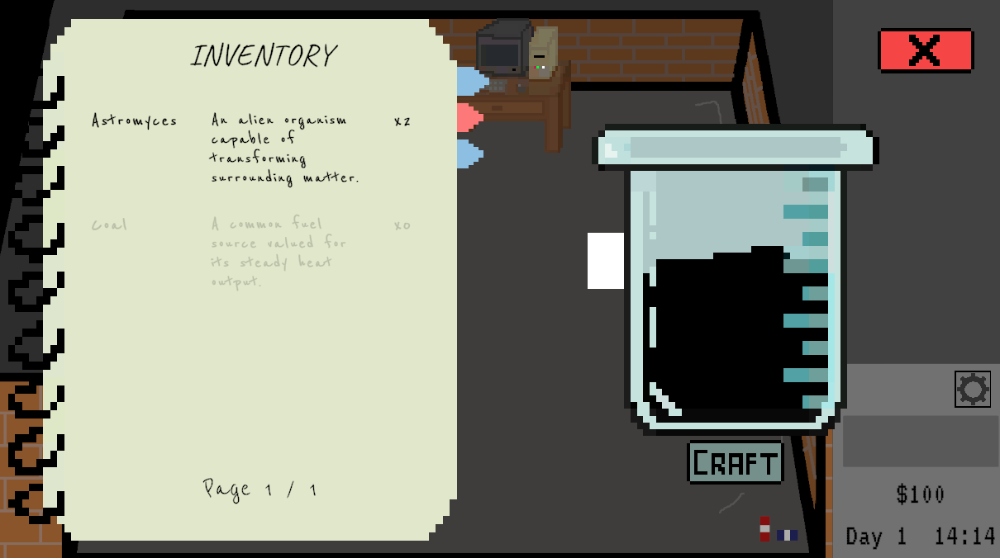

# Project Eclipse

A 2D game made in Unity where you manage a small cultivation and production business centered around **Astromyces**, a highly reactive alien fungus.

## Story

After being rejected by university, the protagonist spends a night in deep sadness. That same night, a meteorite crashes into his backyard. Inside, he discovers Astromyces, an alien fungus with extraordinary reactivity and reproduction capabilities.

Determined to prove the university wrong, he begins cultivating the fungus, producing mixtures, and fulfilling orders, gradually building a business around his discovery.

## Features

- **Fungus cultivation:** Grow Astromyces on an upgradeable cultivation table.
- **Chemical crafting:** Create mixtures by dragging reagents into a beaker.
- **Research notebook:** Manage your inventory and keep track of discovered recipes.
- **Reagent shop:** Purchase ingredients organized into categories.
- **Day cycle:** Sleep to advance to the next day.
- **Missions and orders:** A mission and order system is currently in development.

## Controls

| Action | Key |
|---|---|
| Move | W, A, D, S / Arrow keys |
| Interact | E |
| Open/close notebook | Tab |
| Close panels | Esc |
| Drag reagents into the beaker | Left mouse button |

## Screenshots

**Main Menu**

**Crafting System**

## How to Run

1. Clone this repository.
2. Open the project in Unity using the appropriate Unity version.
3. Open the scene located at `Assets/Scenes/` and press **Play**.

*Note: Replace the instructions above with the exact Unity version and scene name before publishing.*

## Script Structure

- `Scripts/Data`: ScriptableObjects for items, recipes, and ingredients.
- `Scripts/GameManager`: Inventory, money, recipes, day cycle, and shop management.
- `Scripts/Interactables`: Objects the player can interact with.
- `Scripts/Interfaces`: Panels for the notebook, shop, crafting, and sleeping.
- `Scripts/UI`: UI components and visual utilities.
- `Scripts/Player`: Player movement and interaction.

## Author

Nicolás