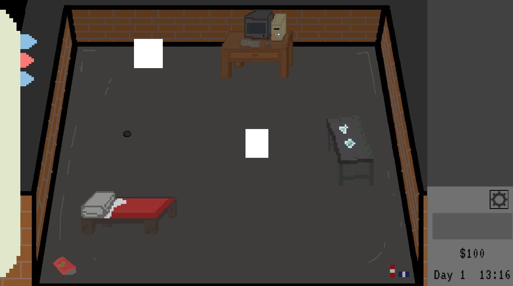

# Project Eclipse

**Language: English** | [Español](#project-eclipse-español)

A 2D game made in Unity where you manage a small cultivation and production business centered around **Astromyces**, a highly reactive alien fungus.

## Story

After being rejected by university, the protagonist spends a night in deep sadness. That same night, a meteorite crashes into his backyard. Inside, he discovers Astromyces, an alien fungus with extraordinary reactivity and reproduction capabilities.

Determined to prove the university wrong, he begins cultivating the fungus, producing mixtures, and fulfilling orders, gradually building a business around his discovery.

## Features

- **Fungus cultivation:** Grow Astromyces on an upgradeable cultivation table.
- **Chemical crafting:** Create mixtures by dragging reagents into a beaker.
- **Research notebook:** Manage your inventory and keep track of discovered recipes.
- **Reagent shop:** Purchase ingredients organized into categories.
- **Day cycle:** Sleep to advance to the next day.
- **Missions and orders:** A mission and order system is currently in development.

## Controls

| Action | Key |
|---|---|
| Move | W, A, D, S / Arrow keys |
| Interact | E |
| Open/close notebook | Tab |
| Close panels | Esc |
| Drag reagents into the beaker | Left mouse button |

## Screenshots

**Main Menu**

**Crafting System**

**Reagent Shop**

## How to Run

1. Clone this repository.
2. Open the project in Unity using the appropriate Unity version.
3. Open the scene located at `Assets/Scenes/` and press **Play**.

*Note: Replace the instructions above with the exact Unity version and scene name before publishing.*

## Script Structure

- `Scripts/Data`: ScriptableObjects for items, recipes, and ingredients.
- `Scripts/GameManager`: Inventory, money, recipes, day cycle, and shop management.
- `Scripts/Interactables`: Objects the player can interact with.
- `Scripts/Interfaces`: Panels for the notebook, shop, crafting, and sleeping.
- `Scripts/UI`: UI components and visual utilities.
- `Scripts/Player`: Player movement and interaction.

## Author

Nicolás

---

# Project Eclipse (Español)

**Idioma: Español** | [English](#project-eclipse)

Juego 2D hecho en Unity donde gestionas un pequeño negocio de cultivo y producción de **Astromyces**, un hongo alienígena de alta reactividad.

## Historia

Tras ser rechazado de la universidad, el protagonista pasa una noche de profunda tristeza. Esa misma noche, un meteorito cae en su patio trasero. Dentro descubre Astromyces, un hongo alienígena con una capacidad de reacción y reproducción extraordinarias.

Decidido a demostrar que la universidad se equivocó, empieza a cultivarlo, producir mezclas y aceptar pedidos, construyendo poco a poco un negocio a su alrededor.

## Características

- **Cultivo:** Cultiva Astromyces en una mesa que se puede mejorar.
- **Crafteo químico:** Crea mezclas arrastrando reactivos al vaso de precipitados.
- **Cuaderno de investigación:** Gestiona el inventario y consulta las recetas descubiertas.
- **Tienda de reactivos:** Compra ingredientes organizados por categorías.
- **Ciclo de días:** Duerme para avanzar al siguiente día.
- **Misiones y pedidos:** Sistema actualmente en desarrollo.

## Controles

| Acción | Tecla |
|---|---|
| Moverse | W, A, S, D / Flechas |
| Interactuar | E |
| Abrir/cerrar cuaderno | Tab |
| Cerrar paneles | Esc |
| Arrastrar reactivos al vaso | Clic izquierdo |

## Capturas

**Menú principal**

**Sistema de crafteo**

**Tienda de reactivos**

## Cómo ejecutarlo

1. Clona el repositorio.
2. Abre el proyecto con la versión correspondiente de Unity.
3. Abre la escena ubicada en `Assets/Scenes/` y presiona **Play**.

*Nota: Completa las instrucciones con la versión exacta de Unity y el nombre de la escena antes de publicar.*

## Estructura de scripts

- `Scripts/Data`: ScriptableObjects de objetos, recetas e ingredientes.
- `Scripts/GameManager`: Gestión del inventario, dinero, recetas, días y tienda.
- `Scripts/Interactables`: Objetos con los que el jugador puede interactuar.
- `Scripts/Interfaces`: Paneles del cuaderno, tienda, crafteo y descanso.
- `Scripts/UI`: Componentes visuales y utilidades de interfaz.
- `Scripts/Player`: Movimiento e interacción del jugador.

## Autor

Nicolás